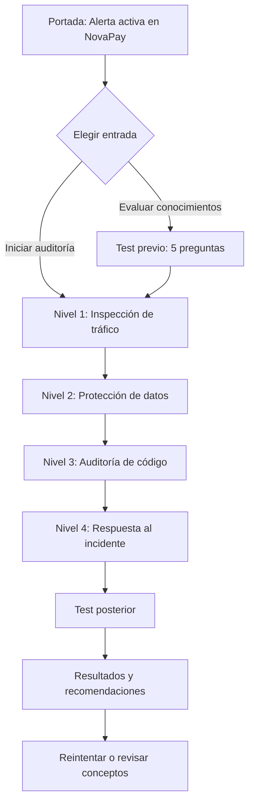

# Plan de mejora UX y Game Feel — Alerta de Fuga

**Versión:** 2.0 (revisión del `implementation_plan.md`)  
**Proyecto:** Alerta de Fuga — Auditoría Criptográfica  
**Contexto:** juego educativo web sobre OWASP A04:2025 — Fallas Criptográficas  
**Tipo de trabajo:** mejora incremental de una implementación existente; no reconstrucción desde cero.

> **Estado del documento:** especificación propuesta para implementación. Los problemas descritos provienen del diagnóstico del plan original; este documento no certifica una auditoría propia del código ni una prueba completa del sitio en navegador. Las 255 pruebas se indican como línea base declarada y deben comprobarse antes y después de los cambios.

## 1. Objetivo y diagnóstico

Convertir una interfaz educativa que se percibe como cuestionario/panel técnico en una **experiencia de investigación y respuesta a incidentes**, ágil y comprensible, sin sacrificar el rigor OWASP/PCI DSS, el diseño responsive, la accesibilidad WCAG 2.2 AA ni la política CSP actual.

**Fricciones a resolver:**

1. **Entrada poco atractiva:** obligar a iniciar con cinco preguntas largas retrasa la experiencia lúdica.
2. **Carga cognitiva excesiva:** las pistas relevantes están enterradas en bloques extensos de texto.
3. **Información de partida fuera de vista en móvil:** exposición, puntos y racha no acompañan al jugador al decidir.
4. **Respuesta poco perceptible:** los aciertos, errores, rachas y cierres de nivel carecen de impacto inmediato.
5. **Retroalimentación demasiado densa:** las explicaciones están separadas de la decisión y exigen desplazamiento.
6. **Progresión narrativa débil:** las cuatro mecánicas se sienten más como ejercicios separados que como una operación de ciberdefensa.

### Principios de diseño

- **Investigar, decidir y observar consecuencias:** no premiar solo la lectura de etiquetas.
- **Mostrar las pistas, no la solución:** antes de responder, usar señales neutrales (protocolo, versión, estado) y reservar verde/rojo de veredicto para después.
- **Lectura por capas:** resumen inmediato, explicación pedagógica breve y detalle técnico expandible.
- **Diseño inclusivo:** ninguna pista, premio o consecuencia depende únicamente del color, sonido o animación.
- **Primero jugabilidad; después pulido:** funcionalidad y claridad antes que audio, brillos o efectos decorativos.
- **Cambios compatibles:** conservar puntuaciones, progreso y contratos públicos salvo modificación justificada y probada.

## 2. Decisiones de implementación adoptadas

| Aspecto | Decisión | Motivo |
| --- | --- | --- |
| Inicio | CTA principal **Iniciar auditoría**; test previo opcional y visible | Acceso inmediato al juego sin eliminar evaluación pedagógica |
| Test de aprendizaje | Quien omite el previo recibe resultado posterior, **sin delta de mejora** | No inventar métricas |
| Audio | **Desactivado por defecto**, activable por gesto explícito | Evitar molestias y bloqueos de reproducción |
| Efectos de audio iniciales | Solo **acierto, error y nivel completado** | Reducir alcance; rachas y alarmas después, si aportan |
| Textos técnicos | Mantener el contenido explicativo; añadir títulos y resúmenes visibles | Menos carga visual sin perder precisión |
| Opciones del nivel 4 | Título corto + detalle breve, manteniendo distinciones técnicas | Decisiones rápidas pero informadas |
| Señales previas a responder | Chips con icono y datos **neutrales**, sin veredicto cromático | Evitar resolver por colores |
| Estado de sonido | Revisar contrato del estado antes de decidir dónde persistirlo | No deformar arquitectura por aserciones antiguas |
| Narrativa | Conectar los cuatro niveles mediante una operación NovaPay | Aumentar motivación sin crear motor narrativo complejo |

**No se requiere una pausa de aprobación por cada decisión anterior:** son valores por defecto propuestos para esta revisión, ajustables si el producto exige otra cosa.

## 3. Experiencia objetivo

### 3.1 Flujo del jugador



### 3.2 Narrativa breve y continua: «Operación Contener la Fuga»

- **Inicio:** «Se detectó actividad sospechosa en NovaPay. Tu misión es identificar las fallas antes de que escale la exposición».
- **Nivel 1 — Inspección de tráfico:** el analista identifica comunicaciones potencialmente inseguras.
- **Transición 1→2:** «Encontramos comunicaciones vulnerables. Ahora revisa qué datos podrían quedar expuestos».
- **Nivel 2 — Protección de datos:** decide cómo proteger o minimizar datos sensibles.
- **Transición 2→3:** «Los registros revelan configuraciones riesgosas. Busca el origen en el repositorio».
- **Nivel 3 — Auditoría de código:** detecta secretos y malas prácticas criptográficas.
- **Transición 3→4:** «La exposición se convirtió en incidente. Coordina la contención».
- **Nivel 4 — Respuesta al incidente:** toma decisiones ramificadas y observa consecuencias.
- **Cierre:** resumen de amenazas identificadas, controles aprendidos, objetivos débiles y próxima acción sugerida.

**Restricción:** estas transiciones deben ser breves y reutilizar el estado actual; no crear cinemáticas obligatorias ni bloquear la navegación.

### 3.3 Ciclo de cada reto

1. **Misión concreta:** una frase que indique qué decidir.
2. **Evidencia visual:** datos relevantes escaneables; detalle técnico disponible.
3. **Decisión:** controles claros, accesibles y distinguibles.
4. **Consecuencia inmediata:** veredicto, puntos o exposición, sin sustituir la explicación.
5. **Aprendizaje por capas:** resumen → «Qué vio el atacante» → «Por qué» → «Control correcto» → detalle expandible.
6. **Continuar:** botón visible y con foco gestionado correctamente; sin saltos de pantalla inesperados.

## 4. Cambios por prioridad

### P0 — Jugabilidad, comprensión y móvil (obligatorio)

#### 4.1 Portada e inicio — `js/views/homeView.js`

- Cambiar el CTA principal a **«Iniciar auditoría»**, que conduce al nivel 1 o al primer nivel disponible según la política de desbloqueo vigente.
- Mantener **«Test previo (5 preguntas)»** como alternativa secundaria claramente identificada; incluir una explicación breve de su utilidad.
- Mostrar un mensaje-misión de una frase, progreso `0/4` a `4/4` y tarjetas de los cuatro niveles con una línea descriptiva cada una.
- Mantener acceso a guía rápida, glosario y ajustes.
- No alterar silenciosamente las reglas de desbloqueo ni la persistencia de resultados.

#### 4.2 HUD visible en dispositivos pequeños — `css/layout.css`, `js/views/gameView.js`

- Presentar **puntos, racha, exposición y avance del reto** en una barra compacta en la parte superior.
- Usar `position: sticky` con un desplazamiento coherente respecto al encabezado; evitar superposición con menús, modales y teclado virtual.
- Garantizar que **la decisión y las pistas principales sigan visibles**; el HUD no debe consumir una porción excesiva del alto útil.
- Mostrar la exposición como porcentaje, icono, texto y barra con semántica accesible (`role="progressbar"`, nombre y valores coherentes).
- En escritorio, permitir sidebar si mejora el uso del espacio, sin duplicar información contradictoria.

#### 4.3 Evidencia visual neutral — `css/components.css`, `css/minigames.css`

- Crear chips de datos como `HTTP`, `TLS 1.3`, `CERTIFICADO: VENCIDO`, `HSTS: AUSENTE`, `AES-ECB`, `CVV`.
- Antes de la decisión, usar una presentación **informativa y neutral**: icono + texto + estructura, sin convertir el color en indicación anticipada de respuesta.
- Después de la decisión, usar estados **Correcto / Riesgo / Revisión** con icono, texto y color redundantes.
- Mostrar el contexto junto a la señal: por ejemplo, **HSTS ausente no equivale por sí solo a una conexión HTTPS vulnerada**.

#### 4.4 Feedback inmediato con profundidad opcional — `js/views/gameView.js`

- Al responder, mostrar un banner inequívoco: «Amenaza contenida» o «Decisión riesgosa», acompañado del cambio real: `+100 puntos`, `+50 racha`, `+20 % exposición`, etc.
- Obtener todos los deltas del motor de puntuación existente; **no recalcularlos en la vista**.
- Reorganizar el contenido en tres bloques breves: **Qué observó el atacante**, **Por qué importa**, **Control recomendado**.
- Conservar el texto completo y las referencias en una sección **«Ver explicación técnica»** expandible, si el contenido es largo.
- Situar **«Continuar»** inmediatamente después del veredicto/resumen. Gestionar foco y región `aria-live` sin duplicar anuncios.
- No activar `Enter` globalmente si puede enviar dos decisiones, disparar un control dentro de un modal o saltarse un contenido que el usuario está leyendo.

#### 4.5 Claridad de los cuatro niveles — `js/minigames/`

**Nivel 1 — `inspector.js`**

- Presentar una cabecera de evidencia de tráfico con protocolo, TLS, certificado y HSTS.
- Dejar cabeceras y payload disponibles en una vista de detalle; nunca ocultar evidencia necesaria para decidir.
- Botones diferenciados por verbo y texto: «Permitir», «Exigir HTTPS/HSTS», «Bloquear» según el escenario.
- Evitar que el indicador visual entregue automáticamente el veredicto.

**Nivel 2 — `classifier.js`**

- Usar iconos y etiquetas claras para contraseñas, datos fiscales, PAN, CVV, ubicación y modos de cifrado.
- Mostrar un contador de tarjetas por destino de protección.
- Mantener controles por clic, tacto y teclado; drag-and-drop no puede ser el único mecanismo.
- En el contenido, distinguir que el **PAN puede tokenizarse** y que el **CVV no debe almacenarse tras la autorización**, incluso cifrado.

**Nivel 3 — `codeHunt.js`**

- Hacer explícito el flujo: «1. Marca la línea vulnerable → 2. Selecciona la corrección».
- Señalar la línea elegida mediante borde, texto y estado de selección, no solo color.
- Mantener navegación de líneas con teclado y la posibilidad de revisar el contexto del archivo.

**Nivel 4 — `branchingIncident.js`**

- Convertir cada decisión en una tarjeta con **título breve + explicación corta**, sin abreviar hasta volver ambiguas las alternativas.
- Mostrar avance de fase y línea de tiempo compacta de decisiones/consecuencias.
- Mantener el grafo existente y sus resultados; las consecuencias deben provenir de las ramas definidas, no de animaciones cosméticas.

### P1 — Identidad de videojuego y progresión (recomendado)

#### 4.6 Continuidad narrativa — `homeView.js`, `gameView.js`, `resultsView.js` y datos de niveles

- Incorporar los mensajes de transición descritos en §3.2.
- Mostrar un objetivo breve por nivel y un cierre de misión que indique qué se protegió o qué riesgo sigue abierto.
- Aprovechar progresión y puntajes existentes. No introducir variables de historia que contradigan el estado real del juego.
- Se permite incorporar campos opcionales como `missionIntro`, `missionComplete` y `shortLabel` a los JSON existentes, con validación y compatibilidad retrospectiva.

#### 4.7 Microinteracciones — `css/tokens.css`, `css/components.css`

- Introducir animación breve en veredictos, rachas y progresión; no aplicar movimientos constantes o sacudidas intensas.
- Mantener los tokens de color base existentes; los derivados son complementarios.
- Respetar `prefers-reduced-motion: reduce` y la preferencia interna de movimiento reducido.
- Evitar estilos inline y dependencias externas incompatibles con la CSP vigente.

### P2 — Pulido opcional (después de validar P0 y P1)

#### 4.8 Audio procedimental — `js/engine/sound.js` (nuevo), `js/main.js`, `js/views/settingsModal.js`

- Implementar Web Audio API con inicialización bajo gesto del usuario y **audio desactivado por defecto**.
- Primera iteración: `playCorrect()`, `playError()` y `playLevelComplete()`.
- Los eventos `playStreak()`, `playFailure()` y `playClick()` quedan diferidos hasta comprobar que añaden valor y no producen saturación.
- Control explícito **«Activar sonido / Silenciar»** con nombre accesible y estado comunicado; no depender únicamente de emojis.
- Si `AudioContext` no existe o está bloqueado, continuar sin sonido y sin fallos.
- El sonido no debe ser la única manera de conocer aciertos, fallos o eventos críticos.

## 5. Arquitectura y compatibilidad

### 5.1 Archivos previstos

| Archivo | Acción | Responsabilidad |
| --- | --- | --- |
| `css/tokens.css` | Modificar | Tokens derivados de animación/elevación sin sustituir los existentes |
| `css/layout.css` | Modificar | HUD responsive y distribución de espacios |
| `css/components.css` | Modificar | Chips, veredictos, tarjetas y microinteracciones |
| `css/minigames.css` | Modificar | Representación visual propia de cada minijuego |
| `js/views/homeView.js` | Modificar | Entrada directa, test opcional, progreso narrativo |
| `js/views/gameView.js` | Modificar | HUD, feedback y transiciones |
| `js/views/resultsView.js` | Modificar si procede | Resumen final conectado con la misión |
| `js/minigames/inspector.js` | Modificar | Evidencia visual de red |
| `js/minigames/classifier.js` | Modificar | Iconos, destinos y recuentos |
| `js/minigames/codeHunt.js` | Modificar | Flujo guiado en dos pasos |
| `js/minigames/branchingIncident.js` | Modificar | Tarjetas de decisión y consecuencias |
| `js/engine/sound.js` | Nuevo, P2 | Audio opcional sin dependencias externas |
| `js/engine/state.js` | Revisar, no modificar automáticamente | Compatibilidad de preferencias y progreso |
| `js/main.js`, `index.html` | Modificar solo si hace falta | Integración de controles y navegación |
| `data/levels/*.json`, `i18n/es.json` | Ampliar opcionalmente | Títulos cortos, narrativa, textos accesibles |
| `tests/` | Ampliar | Cobertura de comportamientos nuevos |

### 5.2 Estado y persistencia

El plan original señala que las pruebas `T2-F03-3` y `T3-02` realizan comparaciones exactas sobre `state.settings`. **No usar esa limitación como criterio único para crear almacenamiento paralelo.**

Procedimiento:

1. Inspeccionar el contrato público del estado, pruebas y consumidoras de `settings`.
2. Si `soundEnabled` pertenece conceptualmente a `settings`, ampliar el esquema y su migración con valor por defecto `false`.
3. Actualizar las pruebas que comprueben una forma antigua **solo si** cambia legítimamente el contrato; preservar las que detectan comportamientos reales.
4. Si hay una razón explícita para no migrar el estado, documentar la alternativa en `alerta_de_fuga_sound_v1` sin dispersar otras preferencias.
5. Verificar que el progreso histórico en `alerta_de_fuga_progress_v1` no se pierde ni se reinicia.

### 5.3 Seguridad del frontend

- Mantener CSP estricta y contenido/script/estilos locales según la política existente.
- No introducir `onclick=`, atributos de estilo dinámicos innecesarios ni inyección HTML no sanitizada.
- Los ejemplos de claves, tarjetas y credenciales deben ser **ficticios**.
- Mantener clara la diferencia entre cifrado, hash, tokenización y eliminación; no sustituir precisión por efectos visuales.
- Revisar las menciones a TLS, HSTS y RSA para evitar reglas universales técnicamente incorrectas.

## 6. Verificación y criterios de aceptación

### 6.1 Línea base

Antes de editar código:

- Ejecutar la suite automatizada y registrar cantidad real de pruebas que pasan, fallan o se omiten.
- Capturar pantallas de portada, HUD móvil y un reto de cada nivel.
- Confirmar el comportamiento actual del test previo, desbloqueos, puntaje, exposición, persistencia y reinicios.

Comando indicado por el plan original (ajustar si la estructura del repositorio difiere):

```bash
node --test \
  tests/scoring.test.js \
  tests/data-integrity.test.js \
  tests/e2e/tier1-features.test.js \
  tests/e2e/tier2-boundaries.test.js \
  tests/e2e/tier3-combinations.test.js \
  tests/e2e/tier4-scenarios.test.js
```

**Objetivo:** mantener las **255 pruebas reportadas** pasando, o el número real comprobado en la línea base, y añadir pruebas relevantes sin rebajar cobertura ni desactivar validaciones.

### 6.2 Pruebas funcionales específicas

| ID | Escenario | Criterio de aceptación |
| --- | --- | --- |
| UX-01 | Inicio sin test previo | Accede a la misión sin bloqueo y completa la ruta |
| UX-02 | Inicio con test previo | Registra el resultado y lo compara al finalizar |
| UX-03 | Omisión del test previo | No aparece una mejora ficticia ni un delta vacío |
| UX-04 | HUD en móvil | Puntos, racha, exposición y avance son visibles sin tapar controles |
| UX-05 | Señales antes de responder | Proveen información, pero no revelan la respuesta por color |
| UX-06 | Acierto y error | Veredicto y delta corresponden exactamente al motor de puntuación |
| UX-07 | Explicación expandible | Conserva el detalle técnico y puede operarse con teclado |
| UX-08 | Nivel 2 táctil/teclado | Clasificación completamente realizable sin arrastrar |
| UX-09 | Nivel 3 | Línea seleccionada y corrección quedan claras, con foco visible |
| UX-10 | Nivel 4 | Cada rama muestra consecuencias coherentes con el estado |
| UX-11 | Progreso y reintentos | No se rompen desbloqueos, exposición ni mejores puntuaciones |
| UX-12 | Audio desactivado | El juego opera sin sonido y conserva la preferencia |
| UX-13 | Audio no disponible | La Web Audio API ausente no bloquea ningún nivel |
| UX-14 | Movimiento reducido | No hay efectos que dependan de animación para entender el juego |
| UX-15 | Navegación con teclado | Se puede terminar la partida sin ratón |
| UX-16 | Persistencia | Los datos previos compatibles permanecen después de actualizar |

### 6.3 Pruebas de navegador

Probar al menos en `390×844`, `768×1024` y `1280×800` mediante navegador real/Playwright:

- Partida completa: portada → test opcional → niveles 1 a 4 → test posterior → resultados.
- Escenarios correctos e incorrectos, rachas, exposición al `100 %`, reintentos y reapertura del juego.
- Ausencia de desplazamiento horizontal no intencional, controles ocultos, elementos superpuestos y pérdida del foco.
- `0` excepciones JavaScript no controladas y `0` recursos requeridos con respuesta `404`.
- Validación de semántica accesible, contraste, modales, uso exclusivo de teclado y anuncios de estado.
- Verificación real de CSP (no basta con que un escáner estático pase).
- Comparación visual antes/después y evidencia en `walkthrough.md` o reporte QA.

### 6.4 Prueba pedagógica con usuarios

Observar al menos cinco personas del público objetivo, sin solicitar datos personales innecesarios. Registrar:

- Si entienden la misión en los primeros segundos.
- Si saben dónde mirar y cómo tomar una decisión sin ayuda.
- Si pueden explicar **por qué** una respuesta fue segura o insegura después del feedback.
- Si comprenden cómo puntos, rachas y exposición responden a sus acciones.
- Dónde dudan, se equivocan por ambigüedad o abandonan.

**Importante:** tener pruebas automatizadas en verde no prueba que la experiencia sea intuitiva, divertida ni que haya aprendizaje.

## 7. Orden de ejecución sugerido

### Fase 0 — Línea base y compatibilidad

Verificar estructura real, datos, estado, pruebas y capturas. No modificar lógica de puntuación.

### Fase 1 — P0: eliminar fricción

Inicio directo, test opcional, HUD móvil, chips neutrales, feedback inmediato, textos por capas y controles claros en cada minijuego. Validar teclado y móvil antes de continuar.

### Fase 2 — P1: construir identidad de juego

Unir los cuatro niveles con narrativa breve, reforzar consecuencias y añadir microinteracciones accesibles. Validar con jugadores.

### Fase 3 — P2: pulido audiovisual

Añadir sonido opcional y mejoras decorativas **solo si** la partida completa es estable y los problemas principales de comprensión están resueltos.

### Fase 4 — Regresión y despliegue

Ejecutar pruebas, revisar seguridad/accesibilidad, probar despliegue público y documentar las mejoras realizadas y el uso de IA.

## 8. Definición de terminado (Definition of Done)

La mejora se considera terminada cuando:

- [ ] El jugador puede empezar a jugar sin completar obligatoriamente el test previo.
- [ ] El test previo sigue disponible y la comparación pre/post solo aparece cuando corresponde.
- [ ] Se ven los indicadores del HUD al tomar decisiones en móvil.
- [ ] Ningún color o sonido revela o sustituye por sí solo el razonamiento técnico.
- [ ] Cada decisión produce un veredicto y una consecuencia trazables al motor existente.
- [ ] El detalle educativo sigue disponible sin saturar la pantalla principal.
- [ ] Los cuatro minijuegos son diferentes, claros y completables con teclado o tacto.
- [ ] Existe continuidad narrativa breve entre los cuatro niveles.
- [ ] El estado, la puntuación, la exposición y los reintentos conservan sus reglas originales.
- [ ] La versión anterior del estado local es compatible o tiene migración verificada.
- [ ] Las pruebas existentes siguen pasando; se añadieron pruebas para las nuevas funciones.
- [ ] Se hizo al menos una partida completa en navegador real para móvil y escritorio.
- [ ] No existen errores de consola no controlados, recursos esenciales perdidos ni bloqueos de accesibilidad conocidos.
- [ ] La política CSP continúa operativa y el despliegue público funciona.
- [ ] Se registraron resultados de pruebas con usuarios y se corrigieron las fricciones críticas identificadas.

## 9. Alcance excluido

No forman parte de esta mejora, salvo decisión posterior justificada: backend, cuentas de usuario, multijugador, ranking remoto, telemetría personal, reescritura de los cuatro niveles, motor narrativo complejo, cinemáticas largas ni sustitución del sistema de puntuación.

---

## 10. Resultado esperado

**Alerta de Fuga debe sentirse como una misión de ciberdefensa en la que el jugador descubre pistas, toma decisiones con criterio y observa consecuencias.** La estética arcade-consola apoya esa experiencia, pero no la reemplaza. La mejora tiene éxito si el juego resulta más claro y atractivo **sin transformar los retos criptográficos en una simple prueba de reconocer colores**.
